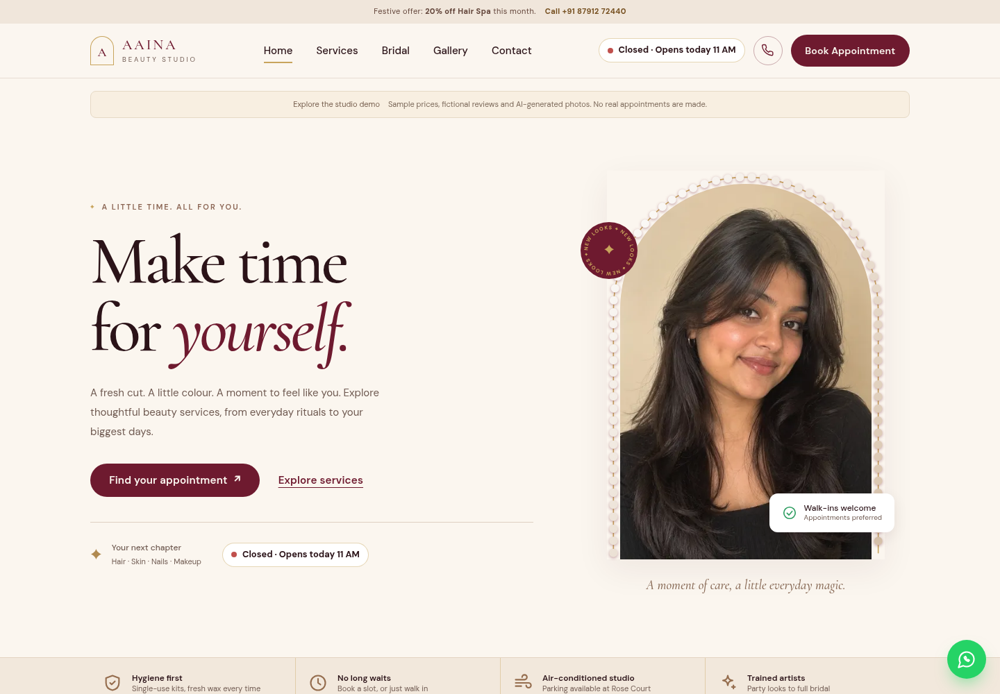
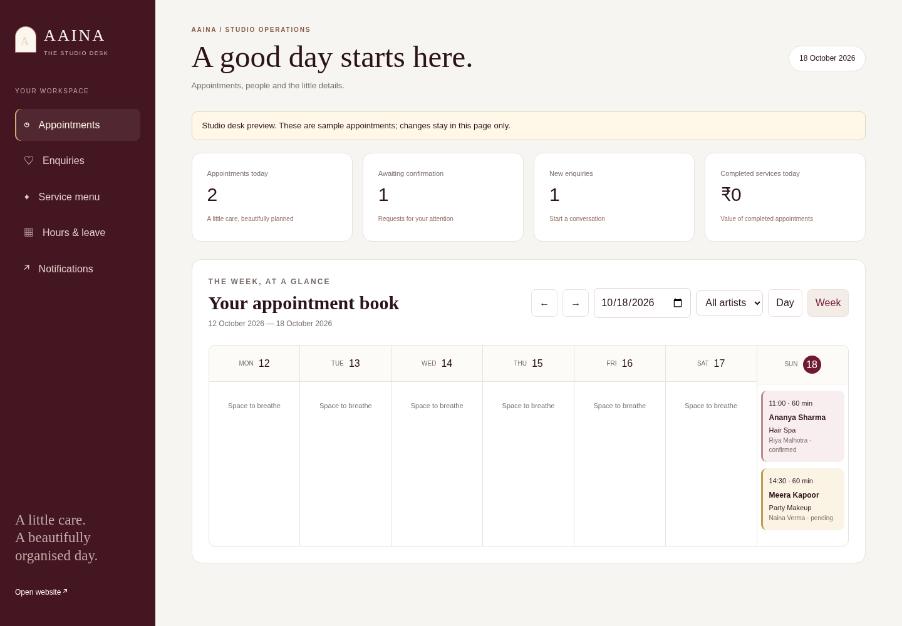
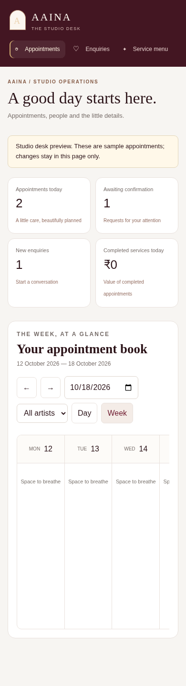

# Implementation validation

Validated locally with Node 26.12.0, Playwright and headless Chromium. CI targets Node 24.

- `npm run check`: JavaScript syntax and local asset references passed.
- `npm test`: 21 tests passed, covering interval conflicts, qualified artist allocation, opening hours/leave, IST time handling, session ownership and admin access, atomic/idempotent booking, immutable price snapshots, cancellation limits, reward reservation, provider contracts, outbox retries and SQLite persistence across restart.
- `AXE_STRICT=1 npm run test:browser`: passed customer and staff journeys in demo/live modes with injected test verification, including request, staff confirmation, reschedule, cancel, logout, calendar download, favourites, storage recovery and customer-text escaping.
- All six principal pages were checked at 1440px, 390px and 320px with no document-level horizontal overflow or browser JavaScript errors.
- Axe scans on the initial home, services, bridal, booking, app and admin screens reported no serious or critical findings. This is an automated check of those states, not a comprehensive accessibility certification.
- The public catalogue remained available offline; live booking creation failed offline. Authentication, API data and admin pages bypass service-worker caching.

The homepage's 480px WebP variants total approximately 710 KB versus 4.41 MB of referenced JPEG fallbacks (83.9% smaller). Bridal variants total approximately 935 KB versus 4.11 MB (77.3% smaller). These compare source asset sizes across the full pages; they are not measured initial-load transfer or field performance results.

Real SMS, external notification delivery, Docker deployment, and genuine business content require operator setup. Provider contract tests and browser test adapters do not establish live provider delivery.

## UI review

| Homepage — desktop | Homepage — phone |
|---|---|
|  |  |

| Studio desk — desktop | Studio desk — phone |
|---|---|
|  |  |

The studio desk screenshots show labelled sample data. Browser artifacts and the full axe report are produced by CI.
